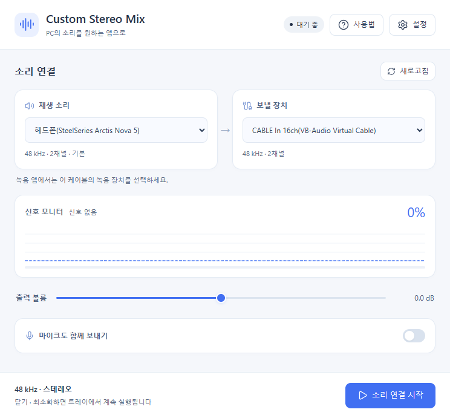

<p align="center"></p>
<h1 align="center">Custom Stereo Mix</h1>
<p align="center"><a href="README.md">한국어</a> · English · <a href="README.ja.md">日本語</a> · <a href="README.zh-CN.md">简体中文</a></p>
<p align="center">Custom stereo mix for Windows — send PC playback and your microphone to Discord, OBS, recording and STT apps</p>
<p align="center"><a href="#quick-start">Quick start</a> · <a href="#installation">Installation</a> · <a href="#build">Build</a> · <a href="#troubleshooting">Troubleshooting</a></p>
<p align="center"></p>
<p align="center"><sub>The screenshot shows the Korean interface with real Windows devices. Device names depend on your PC.</sub></p>

**Custom Stereo Mix brings stereo mix functionality to Windows.** Even if your sound device has no built-in Stereo Mix input, this desktop app captures playback from your selected headphones or speakers and sends it to another app through a virtual audio cable. You can also mix in a physical microphone to send PC audio and your voice as a single input.

## Features

- **Custom stereo mix** — capture playback from a selected device for Discord, OBS, recorders and speech-to-text apps.
- **PC audio + microphone** — optionally include a physical microphone and adjust both gains separately.
- **Monitor and processing** — live signal visualization, output gain, optional compression and a final limiter.
- **System tray** — keep routing when the window closes or minimizes; start, stop or exit from the tray.
- **Saved settings** — device IDs, settings backups, recovery and reset.
- **Built-in guide** — first-run instructions and a virtual cable setup guide you can reopen anytime.
- **Four languages** — Korean, English, Japanese and Simplified Chinese, selectable during installation and in Settings.

> **Additional setup required:** install a **virtual audio cable separately** to use stereo mix. VB-CABLE, VAC and other products with paired playback and recording endpoints can work. A virtual audio driver is not included in this installer.

<a id="quick-start"></a>
## Stereo mix quick start

1. Install a virtual cable from the [official VB-CABLE page](https://vb-audio.com/Cable/). Follow its instructions for administrator installation and restart Windows.
2. In **Playback source**, select the headphones or speakers actually playing your audio.
3. Select `CABLE Input` as the **Output target**, then click **Start routing**.
4. In Discord, OBS, your recorder or STT app, select `CABLE Output` as the **input device**.

```text
Headphone / speaker playback
  → Custom Stereo Mix [optional microphone mix]
  → CABLE Input  [playback endpoint]
  → CABLE Output [recording endpoint]
  → Discord / OBS / Recorder / STT
```

For another virtual cable, send audio to its playback endpoint and select the paired recording endpoint in the receiving app. Routes back to the same device and virtual cable recording inputs used as microphones are blocked to prevent feedback.

<a id="installation"></a>
## Installation

| Requirement | Details |
| --- | --- |
| Windows x64 | Current distribution target. |
| WebView2 Runtime | Required for the interface. The installer runs Microsoft's official runtime setup if it is missing. |
| Virtual audio cable | Install separately; the installer does not bundle an audio driver. |
| .NET Runtime | Included in the release build. Running the app does not require the .NET SDK. |

Download the installer from [GitHub Releases](https://github.com/jinhyeonseo01/Custom-Stereo-Mix/releases), or [build from source](#build). Pushing a `vX.Y.Z` tag creates a release through GitHub Actions.

- Installer: `artifacts\setup\CustomStereoMix-1.2.2-Setup-x64.exe`
- Folder distribution: run `artifacts\webview2\CustomStereoMix.App.exe`

Installation uses a per-user directory. Internet access is needed if WebView2 must be installed. VB-CABLE driver installation requires administrator privileges separately.

**Distribute the entire `artifacts\webview2` folder.** The executable needs `wwwroot`, the WebView2 loader and the other DLLs.

## Interface, language and settings

The light interface opens at 760 × 730. Content scrolls in smaller windows while the start/stop action stays in the footer.

| Setting | Behavior |
| --- | --- |
| Guide | Next to Settings. Opens automatically on first launch. **Don't show again** is checked initially and saved when the guide closes. You can always reopen it manually. |
| Use system tray | Enabled by default. Close and minimize hide the window while routing continues. **Exit** in the tray always exits. With the tray disabled, closing exits too. |
| Reset settings | After confirmation, stops routing and restores defaults. Cancel keeps the current settings. |
| Check for updates | At the top of Settings. Checks the latest stable GitHub release and offers its installer and release notes. |
| Display language | Under Settings → App behavior. Changes the interface, tray and instructions immediately without restarting audio. |

Choose a language when the installer starts. Language priority is **saved preference → installer language → Windows display language → English**. Reinstalling preserves a language you already selected in the app. Reset restores the installation default; folder distributions use the Windows language when supported.

<details>
<summary>Settings screenshot</summary>


Scroll down for audio engine settings and reset. Screenshots show the Korean interface.
</details>

<details>
<summary>Guide screenshot</summary>


The Install page button opens the official website. The instructions themselves are available offline.
</details>

<a id="build"></a>
## Build from source

Run all commands in **PowerShell at the repository root**, where this README is located.

| Tool | Required for |
| --- | --- |
| [.NET 10 SDK](https://dotnet.microsoft.com/download/dotnet/10.0) | C# builds. `global.json` selects 10.0.301 or a compatible newer .NET 10 SDK. |
| [Node.js / npm](https://nodejs.org/en/download/) | React UI and icons. Node.js 24 is recommended. |
| [WebView2 Runtime](https://developer.microsoft.com/microsoft-edge/webview2/) | Running the desktop app during development. |
| [Inno Setup 7](https://jrsoftware.org/isdl.php) | Building the multilingual Windows installer. |

The first build restores NuGet and npm dependencies and needs internet access. Deleted caches and dependencies are recreated as needed.

### Build and run

```powershell
dotnet build CustomStereoMix.slnx -c Release
dotnet run --project src\CustomStereoMix.App\CustomStereoMix.App.csproj -c Release
```

The app project invokes npm restoration and the React production build automatically.

### Publish with the helper script

```powershell
.\build_exe.ps1
```

This convenience script checks npm dependencies, regenerates icons and favicon, then runs `dotnet publish`. It is not a separate mandatory build system. The result is a self-contained Windows x64 distribution in `artifacts\webview2\`; keep the full folder.

### Publish directly

```powershell
dotnet publish src\CustomStereoMix.App\CustomStereoMix.App.csproj `
  -c Release `
  -r win-x64 `
  --self-contained true `
  -o artifacts\webview2
```

React builds automatically. This command uses the committed icons. If their source or generation code changed, regenerate them first:

```powershell
.\tools\build_icons.ps1
```

### Build the installer

With Inno Setup on PATH or in a supported default location:

```powershell
.\build_installer.ps1
```

For a custom compiler location:

```powershell
.\build_installer.ps1 -IsccPath 'C:\Program Files\Inno Setup 7\ISCC.exe'
```

The script publishes the app, downloads the official WebView2 bootstrapper, checks its Microsoft signature and builds the installer. Inno Setup 7 supplies all four installer translations.

| Output | Default path |
| --- | --- |
| App and required files | `artifacts\webview2\` |
| Installer | `artifacts\setup\CustomStereoMix-1.2.2-Setup-x64.exe` |

The default version comes from `Directory.Build.props`. The installer's `-Version` argument overrides it for the app and installer.

### Automatic releases from tags

The [GitHub Actions workflow](.github/workflows/release.yml) checks out the tagged commit and builds it on Windows. After committing and pushing the changes:

```powershell
git tag -a v1.2.0 -m "Release v1.2.0"
git push origin v1.2.0
```

The tag version is applied to the app and installer filename. After tests pass, the workflow builds with Inno Setup, uploads the installer and SHA-256 checksum to a draft, then publishes the release. Incomplete drafts are not offered by the app. An already published release is not overwritten.

The workflow uses GitHub's `GITHUB_TOKEN`; no personal token is needed. See the [release guide](docs/RELEASING.md) for retry details (Korean).

### Visual Studio

Open `CustomStereoMix.slnx` in a version supporting .NET 10 and build Release. Both `dotnet` and `npm` must be available. For folder publishing, choose Release / win-x64 / self-contained. Run `build_installer.ps1` separately to package the installer.

### React development

```powershell
cd ui
npm ci
npm run dev
```

Browser preview uses fake devices and signals and displays a preview banner. Actual audio routing runs in the desktop app. The preview bridge is excluded from the production bundle.

### Tests

```powershell
dotnet run --project tests\CustomStereoMix.Tests\CustomStereoMix.Tests.csproj -c Release
```

Tests cover resampling continuity and filtering, surround downmixing, buffers, feedback prevention, settings recovery, bridge validation, startup/reset/shutdown races, update checks and language persistence. Also verify actual devices and receiving apps on the target PC.

<a id="troubleshooting"></a>
## Troubleshooting

| Symptom | What to check |
| --- | --- |
| Signal is visible but Discord/STT is silent | Select the cable's paired **recording** device in the receiving app: `CABLE Output` for VB-CABLE. The monitor cannot verify the receiving app's settings. |
| Signal stays at 0% | Select the device actually playing audio. The saved device ID does not automatically follow Windows default-device changes. |
| Device is missing | Install the cable, restart and Refresh. Known virtual recording cables are excluded from the microphone list to prevent feedback. |
| Audio breaks up | Stop routing and check latency/buffer settings. Buffer duration must be at least latency. Defaults: 48 kHz, stereo, 50 ms latency, 250 ms buffer. |
| Closing leaves the app running | Default tray behavior. Right-click tray → Exit, or disable the tray in Settings. |
| Interface will not open | Keep the complete distribution including `wwwroot` and DLLs, and install WebView2 Runtime. Retry can recover an interface process failure. |
| Build reports locked files | Exit apps running from that output folder. Stop development servers if npm restoration reports native file locks. |

## Updates

Once the interface is ready, the app checks GitHub Releases in the background once per launch. It shows a popup only for a higher stable `vX.Y.Z` version with a ready Windows x64 installer. **Later** dismisses it; **Check for updates** in Settings can check again.

**Download installer** opens the verified official asset link in your browser. Exit from the tray before running the downloaded installer. **Release notes** opens that release's page. No release, offline access, rate limits or server errors leave audio controls usable. Drafts and prereleases are excluded.

## Settings and diagnostics

| Data | Location |
| --- | --- |
| Settings | `%APPDATA%\CustomStereoMix\settings.json` |
| Previous valid settings | `%APPDATA%\CustomStereoMix\settings.json.bak` |
| Audio diagnostics | `%APPDATA%\CustomStereoMix\audio-diagnostics.log` |
| WebView2 profile | `%LOCALAPPDATA%\CustomStereoMix\WebView2` |

Settings save after a short delay and on stop/exit. Diagnostics contain device IDs, formats and buffer state, not captured audio, and rotate at about 1 MB. An underrun during silent playback may mean there are no WASAPI packets; consider its timing alongside the signal.

## Technology and localization

| Component | Role |
| --- | --- |
| C# / .NET 10 / NAudio | WASAPI capture/output, conversion, resampling, mixing and DSP. |
| React / TypeScript / Vite | Interface and commands. |
| WPF / WebView2 | Desktop window, local UI, tray and shutdown. |
| Lucide | Button icons, app icon and favicon. |
| Inno Setup | Per-user Windows x64 installer. |

C# handles PCM audio; the UI bridge carries only commands, state and meters. Refreshing or hiding the interface preserves audio routing. See [project structure](docs/PROJECT_STRUCTURE.md) and [localization](docs/LOCALIZATION.md).

Translations use stable message keys and parameters shared by C# and React. Adding a resource registers another app language; installer language entries are added separately. Windows-provided device names are preserved.

## Issues and contributions

Include your Windows and app versions, source/target/receiving device names, reproduction steps and symptoms. Review device IDs before sharing diagnostic logs. Verify relevant tests and, for UI changes, small windows, tray, settings and guide behavior.

`.gitignore` excludes dependencies, build outputs, installers, local settings/logs/recordings and secrets. Source, lockfiles, documentation screenshots and third-party licenses belong in the repository. Check `git status --short` before upload.

## Third-party notices

Notices are included in [THIRD_PARTY_NOTICES.md](THIRD_PARTY_NOTICES.md) and [licenses](licenses/). Lucide's ISC and Feather-derived MIT notices are in [LUCIDE-LICENSE.txt](ui/public/LUCIDE-LICENSE.txt).

Virtual audio drivers are separate products governed by their own installation, use and redistribution terms. See [VB-Audio's licensing information](https://vb-audio.com/Services/licensing.htm) for VB-CABLE donationware and bundling conditions.
