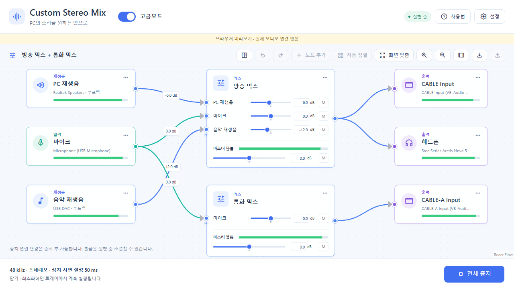
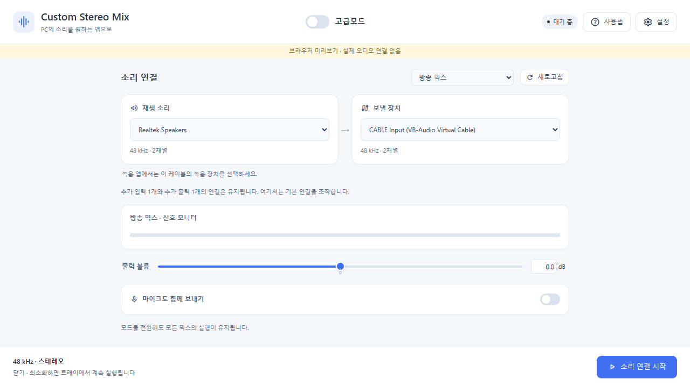
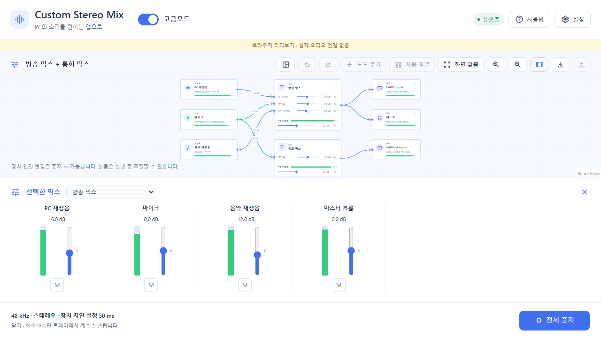
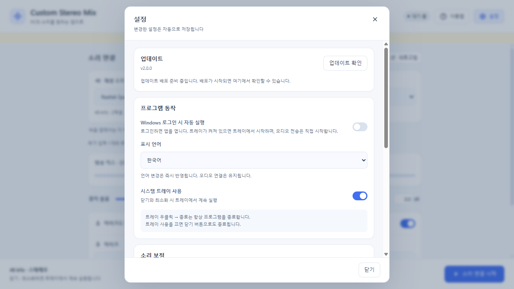
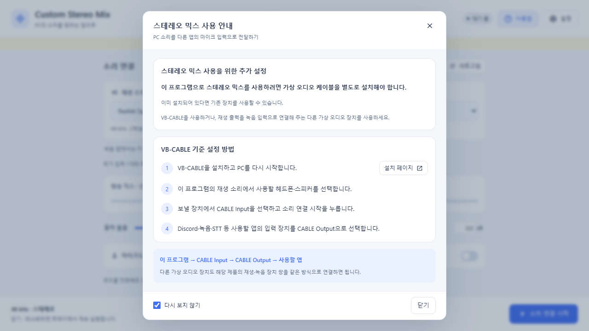

<p align="center"></p>
<h1 align="center">Custom Stereo Mix</h1>
<p align="center">한국어 · <a href="README.en.md">English</a> · <a href="README.ja.md">日本語</a> · <a href="README.zh-CN.md">简体中文</a></p>
<p align="center">Windows의 재생음과 입력을 여러 믹스로 묶어 원하는 출력으로 보내세요.</p>
<p align="center"><a href="#quick-start">빠른 시작</a> · <a href="#advanced">고급모드</a> · <a href="#installation">설치</a> · <a href="#build">빌드</a> · <a href="#troubleshooting">문제 해결</a></p>



*현재 2.0 UI의 브라우저 미리보기입니다. 장치와 미터는 샘플이며 실제 오디오는 Windows 데스크톱 앱에서 처리합니다. 아래 화면도 같은 미리보기에서 캡처했습니다.*

Custom Stereo Mix는 **PC 재생음과 마이크·가상 입력을 혼합하고 여러 출력 장치로 전달하는 Windows 앱**입니다. 간편모드에서는 재생 소리와 보낼 장치를 선택하고, 고급모드에서는 노드와 간선으로 여러 믹스를 구성합니다. 가상 오디오 케이블을 출력으로 사용하면 Discord·OBS·녹음·STT 앱에서 혼합된 소리를 입력으로 받을 수 있습니다.

이 README는 **2.0.0 소스 기준**입니다. 검증한 동작과 남은 안정화 항목은 [검증 기록](docs/VALIDATION.md)에 있습니다.

## 주요 기능

| 기능 | 할 수 있는 일 |
|---|---|
| 간편모드 | 기본 재생음·출력 연결, 마이크 함께 보내기, 믹스 선택과 볼륨 조절 |
| 고급모드 | 여러 재생음·물리/가상 입력 → 여러 믹스 → 여러 출력 구성 |
| 믹스 조작 | 입력별 전송 볼륨·뮤트, 믹스 마스터 볼륨, 선택 믹서 도크 |
| 소리 보정 | 노드별 컴프레서와 버스·출력 리미터, 신호·클리핑·장치 오류 표시 |
| 그래프 편집 | 장치 검색, 포트 드래그 연결, 상세 설정, 자동 정렬, 확대/축소, 실행 취소/재실행 |
| 프로젝트 | JSON 가져오기/내보내기, 자동 저장, 1.x 설정 이관과 백업 |
| 프로그램 동작 | 트레이 실행, 로그인 시 자동 실행 옵션, 업데이트 확인 |
| 다국어 | 한국어·영어·일본어·중국어 간체, 실행 중 언어 변경 |

<a id="quick-start"></a>

## 간편모드로 시작하기

1. Discord·OBS 등 다른 앱의 입력으로 보내려면 [VB-CABLE](https://vb-audio.com/Cable/) 같은 가상 오디오 케이블을 별도로 설치합니다. 일반 헤드폰·스피커로 출력할 때는 필요하지 않습니다.
2. **재생 소리**에서 실제 소리가 나오는 헤드폰·스피커를 선택합니다.
3. **보낼 장치**에서 출력 장치를 선택합니다. VB-CABLE이라면 `CABLE Input`입니다.
4. 목소리도 보낼 경우 **마이크도 함께 보내기**를 켜고 입력 장치와 볼륨을 선택합니다.
5. **소리 연결 시작**을 누릅니다. 받는 앱에서는 짝이 되는 녹음 장치를 선택합니다. VB-CABLE이라면 `CABLE Output`입니다.

```text
PC 재생음 + 마이크
  → Custom Stereo Mix → CABLE Input
  → CABLE Output → Discord / OBS / 녹음 / STT
```



여러 믹스가 있으면 상단에서 조작할 믹스를 선택합니다. 간편모드는 선택한 기본 연결을 편집하며 추가 입력·출력과 다른 믹스를 보존합니다. **모드 전환은 오디오를 중지하지 않습니다.**

<a id="advanced"></a>

## 고급모드 사용하기

상단의 **고급모드**를 켠 뒤 다음 순서로 구성합니다.

1. **노드 추가** 또는 장치 목록에서 재생음·입력·믹스·출력을 추가합니다.
2. 소스의 오른쪽 포트에서 믹스의 왼쪽 포트로, 믹스에서 출력으로 끌어 연결합니다. 상세 설정의 **연결 대상**에서도 연결할 수 있습니다.
3. 믹스 안에서 입력별 전송 볼륨과 뮤트를 조절합니다. 같은 입력은 여러 믹스로 보내고, 같은 믹스는 여러 출력으로 보낼 수 있습니다.
4. 노드의 **…**에서 장치·볼륨·컴프레서·리미터 등을 조절합니다. 간선을 클릭하면 그 연결의 전송 볼륨·뮤트·삭제가 표시됩니다.
5. **전체 시작**으로 연결된 믹스를 실행하고 **전체 중지**로 중지합니다.

**볼륨 슬라이더 중앙은 0 dB**입니다. 왼쪽은 -60..0 dB, 오른쪽은 0..+12 dB이며 숫자로 직접 입력할 수 있습니다. 더블클릭 또는 `0` 키로 0 dB, 방향키로 0.1 dB, Shift+방향키로 1 dB씩 조절합니다.

실행 중에도 볼륨·뮤트·보정은 조절할 수 있습니다. **장치·노드·연결 구조 변경은 중지 후** 적용합니다. 같은 출력 장치를 중복 추가하거나 소리가 다시 입력으로 돌아오는 연결은 차단합니다.

<details>
<summary>선택 믹서 도크</summary>



툴바의 믹서 버튼을 누르면 선택한 믹스의 입력별 페이더·미터·뮤트와 마스터 조작이 표시됩니다. 노드 내부 조작과 같은 설정을 사용합니다.

</details>

툴바에서 프로젝트 JSON을 내보내거나 가져올 수 있습니다. 장치 연결은 이름 대신 Windows 장치 ID를 사용하므로 다른 PC에서 가져온 프로젝트는 해당 PC의 장치로 다시 지정해야 합니다.

<a id="installation"></a>

## 설치와 실행

공개된 설치 파일은 [GitHub Releases](https://github.com/jinhyeonseo01/Custom-Stereo-Mix/releases)에서 확인할 수 있습니다. 소스의 버전 변경만으로 릴리즈가 게시되지는 않습니다.

- **지원 환경:** Windows x64와 WebView2 Runtime.
- **설치기:** WebView2가 없으면 Microsoft 공식 런타임 설치를 진행합니다. 사용자별 경로에 설치합니다.
- **폴더 배포:** `artifacts\webview2\CustomStereoMix.App.exe`를 실행합니다. `wwwroot`, DLL을 포함한 **폴더 전체**가 필요합니다.
- **가상 케이블:** 별도 제품이며 설치기에 동봉하지 않습니다.
- **.NET:** self-contained 배포에는 런타임이 포함됩니다. 소스 빌드에는 SDK가 필요합니다.

닫기·최소화는 기본적으로 트레이로 숨기고 연결을 유지합니다. 실제 종료는 **트레이 우클릭 → 종료**를 사용합니다. 트레이 동작과 자동 실행은 설정에서 변경할 수 있습니다. 자동 실행은 앱만 열며 오디오 전송은 직접 시작합니다.

<details>
<summary>설정과 사용 안내 화면</summary>





설정에는 소리 보정·샘플레이트·채널·지연·버퍼·초기화도 있습니다. 아래로 스크롤해 확인할 수 있습니다. 언어 변경은 연결을 유지하며 화면과 트레이에 즉시 반영됩니다.

</details>

<a id="build"></a>

## 소스에서 빌드

프로젝트 루트의 PowerShell에서 실행합니다. [.NET 10 SDK](https://dotnet.microsoft.com/download/dotnet/10.0) (`global.json` 기준 10.0.301), [Node.js 24 / npm](https://nodejs.org/en/download/), [WebView2 Runtime](https://developer.microsoft.com/microsoft-edge/webview2/)이 필요합니다.

```powershell
dotnet build CustomStereoMix.slnx -c Release
dotnet run --project src\CustomStereoMix.App -c Release
```

C# 빌드에 npm 복원과 React 프로덕션 빌드가 연결되어 있습니다.

| 작업 | 명령 | 결과 |
|---|---|---|
| 폴더 배포 | `.\build_exe.ps1` | `artifacts\webview2\` |
| 설치기 | `.\build_installer.ps1` | `artifacts\setup\CustomStereoMix-2.0.0-Setup-x64.exe` |

설치기 생성에는 Inno Setup 7이 필요합니다. 다른 경로라면 `-IsccPath 'C:\경로\ISCC.exe'`를 지정합니다. 버전은 `Directory.Build.props`에서 관리합니다. 앱 아이콘 원본을 바꿨을 때만 `-RegenerateIcons`를 사용합니다. 태그 기반 자동 배포와 업데이트 동작은 [릴리즈 안내](docs/RELEASING.md)에 있습니다.

### UI 미리보기

```powershell
cd ui
npm ci
npm run dev
```

`http://127.0.0.1:5173/?advanced`에서 고급모드를 확인합니다. **브라우저는 샘플 장치와 미터를 사용하며 실제 오디오는 연결하지 않습니다.** 이 미리보기 브리지는 프로덕션 번들에서 제외됩니다.

### 테스트

```powershell
dotnet run --project tests\CustomStereoMix.Tests -c Release
dotnet run --project tests\CustomStereoMix.Tests -c Release -- --list-audio-devices
```

회귀 검사는 그래프·피드백·믹싱·출력 버퍼·설정 이관/복구·브리지·번역·업데이트를 검증합니다. 실제 장치의 무음 세션 검사 명령과 남은 청취·장시간 테스트는 [검증 기록](docs/VALIDATION.md)에 구분했습니다.

<a id="troubleshooting"></a>

## 문제 해결

| 증상 | 확인 |
|---|---|
| 받는 앱에서 무음 | 앱의 입력이 케이블의 **녹음 장치**인지 확인합니다. VB-CABLE은 `CABLE Output`입니다. |
| 재생음 미터가 움직이지 않음 | Windows에서 실제 소리가 나오는 장치를 재생 소스로 선택합니다. 기본 장치 변경을 자동으로 따라가지 않습니다. |
| 장치가 없거나 오프라인 | 중지 후 **새로고침**합니다. 비슷한 이름의 다른 장치로 자동 교체하지 않습니다. 물리·가상 입력을 모두 표시합니다. |
| 반환 연결 오류 | 입력을 같은 장치나 같은 가상 케이블로 다시 보내지 않도록 경로를 바꿉니다. 외부 앱이 만든 반환 경로도 확인합니다. |
| 일부 출력만 실패 | 노드·상세 오류를 확인하고 해당 장치의 사용 상태를 점검합니다. 다른 정상 출력은 계속 실행될 수 있습니다. |
| 끊김·지연 | 중지 후 지연·버퍼를 조절합니다. 기본값은 48 kHz, 스테레오, 지연 50 ms, 버퍼 250 ms입니다. |
| 화면이나 빌드가 열리지 않음 | WebView2와 배포 폴더 전체를 확인합니다. 빌드 파일 잠금은 실행 중인 앱을 종료한 뒤 재시도합니다. |

자동 장치 재연결은 현재 지원하지 않습니다. 앱별 캡처, EQ, 믹스 간 연결, 실행 중 구조 변경도 이번 버전에 포함하지 않습니다.

## 설정·진단·기여

설정은 `%APPDATA%\CustomStereoMix\settings.json`에 자동 저장됩니다. 정상 설정 백업은 `.bak`, 첫 1.x 이관 백업은 `.v1.bak`입니다. 같은 폴더의 `audio-diagnostics.log`에는 장치·포맷·버퍼 상태가 기록되며 오디오는 저장하지 않습니다. WebView2 프로필은 `%LOCALAPPDATA%\CustomStereoMix\WebView2`에 있습니다.

문제 제보에는 앱·Windows 버전, 장치 이름, 재현 단계와 노드 오류를 포함해 주세요. 로그를 공유하기 전에 장치 ID 등 공개하고 싶지 않은 정보를 확인하세요.

[프로젝트 구조](docs/PROJECT_STRUCTURE.md) · [다국어 확장](docs/LOCALIZATION.md) · [검증 기록](docs/VALIDATION.md) · [릴리즈 안내](docs/RELEASING.md)

UI는 React·TypeScript·React Flow, 호스트는 WPF·WebView2, 오디오는 NAudio/WASAPI로 구성합니다. PCM 처리는 C#에서 수행하고 UI에는 명령·상태·미터만 전달합니다.

외부 라이선스는 [THIRD_PARTY_NOTICES.md](THIRD_PARTY_NOTICES.md)와 [licenses](licenses/)에 포함합니다. UI 아이콘은 Material Symbols, 기존 앱 아이콘·favicon은 Lucide를 사용합니다. 가상 드라이버는 각 제작사의 설치·사용·배포 조건을 따릅니다.
